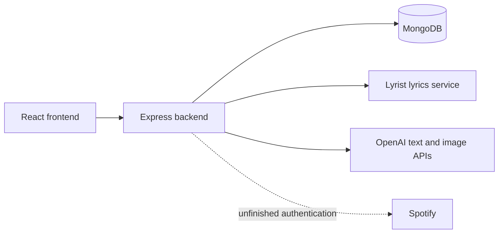

# MoodTunes

A 2023 web application prototype exploring how song lyrics can be turned into AI-generated background images. It combines a React interface, an Express API, MongoDB storage, and external lyrics and image-generation services.

**Status: historical prototype.** The repository preserves an unfinished implementation. It is not deployment-ready, and a working end-to-end setup has not been verified during this cleanup.

## What is in the code

| Area | Implementation and limitations |
| --- | --- |
| Interface | React screens for registration, login, lyrics, generated backgrounds, and saved images. Some component wiring remains incomplete. |
| Lyrics and image generation | Express routes retrieve lyrics, request an image prompt, generate images, and store image data. The integrations use older APIs and need verification before reuse. |
| Persistence | MongoDB collections for users and generated images, with references to users' saved images. |
| Authentication | Password hashing and comparison are implemented, but a successful password login does not establish an authenticated server session. |
| Spotify | A Passport strategy and callback routes are scaffolded. Spotify search, playback, and a complete Spotify account flow are not implemented. |

The original idea was an immersive music player with backgrounds derived from the mood of the current song. The source only implements parts of that idea; playlist support and reverse image-to-music recommendations remained proposals.

## Architecture

- `frontend/src/` contains the interface and HTTP client, currently configured for a backend on `localhost:3001`.
- `backend/app.js` defines the main API routes.
- `backend/lyricsApi.js` and `backend/openai.js` contain external service integrations.
- `backend/models/User.js` contains user persistence and saved-image operations.
- `backend/passport.js` contains the unfinished Spotify authentication setup.

## Configuration

Example configuration is provided in [`backend/.env.example`](backend/.env.example) and [`frontend/.env.example`](frontend/.env.example). Local `.env` files are ignored by Git. The backend reads its database connection from `MONGODB_URI` and its session secret from `SESSION_SECRET`; configuration errors do not print either value.

For future restoration, create `backend/.env` from its example, use a local development database, and supply your own credentials only when testing the corresponding integration. Never reuse credentials found in repository history. The optional frontend example contains only a development setting.

These examples do **not** constitute a working installation guide. The manifests do not yet declare every package imported by the source: the backend is missing `openai`, `axios`, and `bcryptjs`, and the frontend is missing `react-slideshow-image`. The backend also imports `mongodb` directly while currently receiving it through another dependency. Compatible dependency versions and service APIs must be selected and verified before attempting to restore the application.

## Known limitations

- Saved-image endpoints accept a caller-supplied username without verifying ownership. The login UI does not enforce server-side authorization.
- Generation endpoints have no authentication or usage limits. They must not be exposed with real service credentials.
- Session handling, input validation, error handling, and database connection lifecycles need further work.
- Frontend imports and component props include incomplete wiring, and image responses are inconsistent between API paths.
- The backend test command is a placeholder, and the frontend retains its generated starter test. Neither verifies the application workflow.

## What a refresh would involve

A future revival would start with a reproducible local setup and a fixture-based demonstration that does not require paid services. The next steps would be server-side authentication and authorization, consistent API contracts, reliable database connections, explicit dependency declarations, and tests of the main workflow. Only then would it make sense to revisit Spotify playback and live image generation.

The current cleanup focuses on documenting the actual state, moving configuration out of source, and removing committed dependencies. It does not present the prototype as a completed or secure product.
